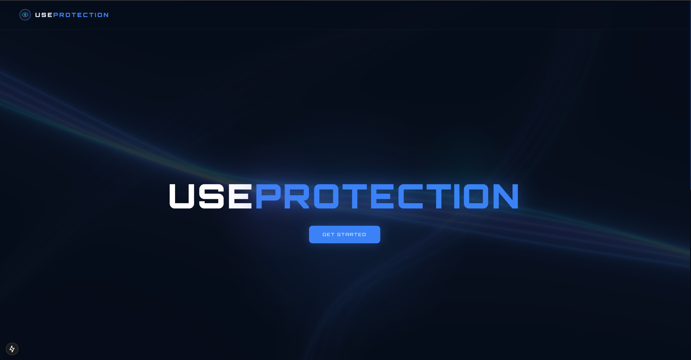
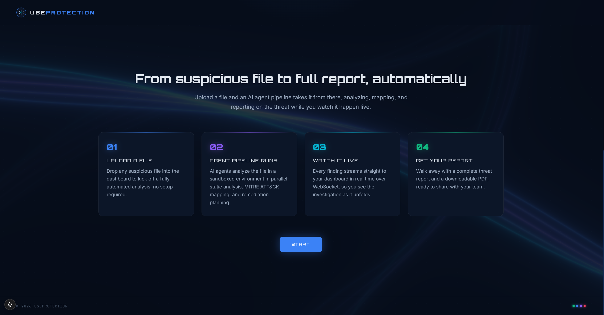
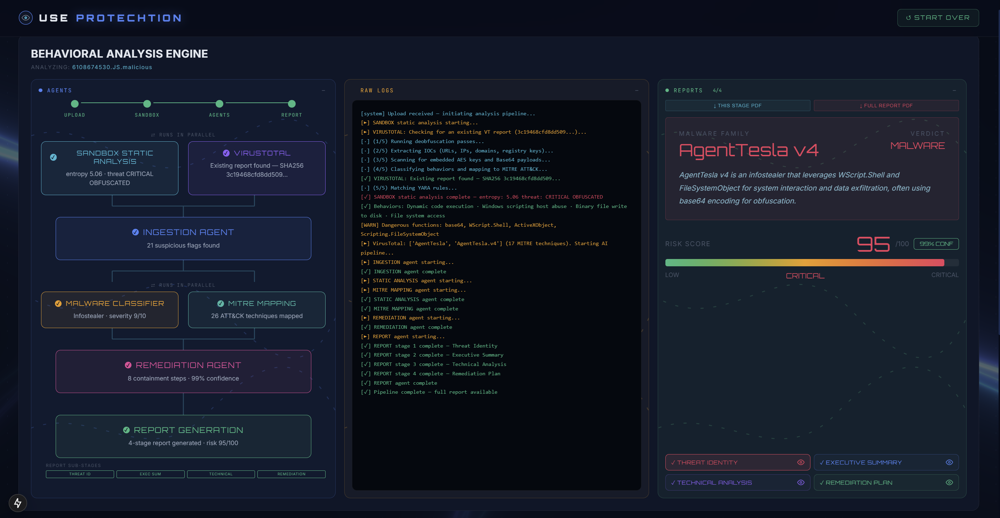
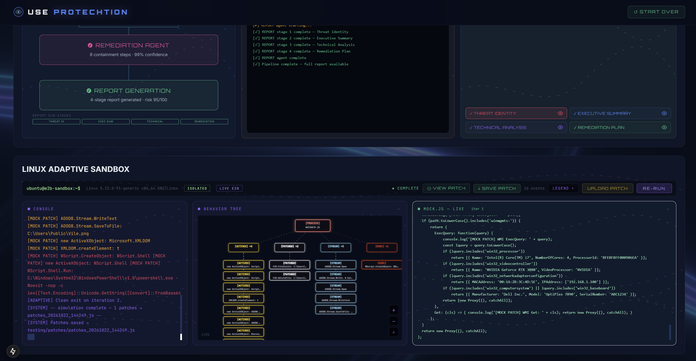

# UseProtection

An AI-powered malware analysis platform. Drop in a suspicious file (or a VirusTotal log) and get back a full automated security report, static analysis, live sandboxed execution, MITRE ATT&CK mapping, and remediation guidance, all streamed in real time to a dashboard.

🏆 **Winner — Cybersecurity & AI Track (sponsored by NextEra)** at HackUSF. [View on Devpost](https://devpost.com/software/use-protech-tion)


<p align="center">
  
  
  
  
  
  
  
  
</p>

Deployment: https://useprotechtion-production.up.railway.app/

## What it does

1. **Upload** a file (or paste a VirusTotal report) through the web UI.
2. A pipeline of AI agents kicks off: static analysis of the file's structure and behavior, VirusTotal enrichment, malware family classification, MITRE ATT&CK technique mapping, and remediation planning.
3. The suspicious file is detonated live inside an **isolated E2B sandbox**. If it crashes on a missing API/environment (common with obfuscated droppers), Gemini reads the crash, generates a JS patch to mock the missing behavior, and re-runs — adapting automatically instead of giving up, with a human-in-the-loop view into every patch.
4. Everything streams live over WebSocket to the dashboard: agent progress, raw pipeline logs, and the sandbox's live console, syscall/behavior tree, and generated patches.
5. A multi-stage report (threat ID → executive summary → technical breakdown → remediation plan) builds progressively and exports to a downloadable PDF.





## Features

- **Parallel agent pipeline** — static analysis, VirusTotal lookups, MITRE ATT&CK mapping, and remediation recommendations run concurrently and stream progress independently.
- **Adaptive E2B sandbox** — detonates the sample in an isolated Linux sandbox; on a runtime crash, an LLM-generated patch mocks the missing API (network, filesystem, ActiveX/WMI, etc.) and the run resumes automatically, up to a bounded number of iterations.
- **Human-in-the-loop patching** — every auto-generated patch is visible and reviewable, with a live syscall/behavior tree, console output, and save/upload controls for the sandbox session.
- **PE / .NET static analysis** — entropy analysis, YARA matching, PE section/import inspection, IOC extraction, and reflective-loading / fileless-execution detection, with built-in handling for large obfuscated scripts.
- **MITRE ATT&CK mapping** — detected behaviors are automatically mapped to ATT&CK technique IDs.
- **Malware family classification & risk scoring** — severity and a 0–100 risk score, surfaced per analysis.
- **Live streaming dashboard** — every pipeline and sandbox event pushes to the UI over WebSocket as it happens, no polling.
- **4-stage report generation** — threat ID, executive summary, technical detail, and remediation each stream in and render independently, with a downloadable PDF export.
- **VirusTotal integration** — enriches analysis with existing VT reports when available.

## Tech Stack

**Frontend**
- Next.js 15 (React 19, TypeScript)
- Three.js for 3D UI elements, Framer Motion for animation/page transitions
- jsPDF for report export
- Static export served by the backend

**Backend**
- Python / FastAPI with WebSockets for real-time event streaming
- Google Gemini (`google-genai`) for all agent/LLM calls
- E2B for isolated sandboxed code execution
- `pefile`, `yara-python`, NetworkX, Matplotlib for static analysis and behavior graphing
- Docker support via `Dockerfile`



## Setup

### Prerequisites
- Python 3.10+
- Node.js 18+
- API keys: Google Gemini, E2B, (optional) VirusTotal

### Windows — one-command setup

Double-click (or run) **`start.bat`** in the project root. It will:

1. Create a Python virtual environment (if one doesn't exist yet)
2. Install backend dependencies (`pip install -r requirements.txt`)
3. Create `.env` from `.env.example` and open it in Notepad so you can drop in your API keys
4. Install frontend dependencies (`npm install`)
5. Start the backend (`:8000`) and frontend dev server (`:3000`) in their own windows, then open the app in your browser

Safe to re-run any time — it skips steps that are already done and just restarts the servers.

### Manual setup (Mac / Linux / Windows)

**Backend**

```bash
python -m venv venv
source venv/Scripts/activate   # Windows
# source venv/bin/activate     # Mac/Linux

pip install -r requirements.txt
cp .env.example .env            # add your API keys
uvicorn app:app --reload
```

**Frontend**

```bash
cd frontend
npm install
npm run dev      # http://localhost:3000
```

The backend serves the API/WebSocket on `:8000`; the frontend dev server on `:3000` talks to it automatically. For a production static build instead of dev mode, run `npm run build` (produces `frontend/out/`) and visit `http://localhost:8000` — the backend serves the static export directly.

## Deployment

Hosted on [Railway](https://railway.app), built from the root `Dockerfile` — one service serves both the FastAPI backend and the static frontend export (`frontend/out/`). Railway auto-deploys on every push to `main`. Set `GEMINI_API_KEY` and `E2B_API_KEY` (and optionally `VT_API_KEY`) as environment variables on the service; `PORT` is injected automatically.

## File Structure

| Folder | What is in it |
|---|---|
| `app.py` | FastAPI app — HTTP/WebSocket routes, job orchestration, and the adaptive sandbox loop |
| `agents/` | The AI agent pipeline (static analysis → VT enrichment → classification → ATT&CK mapping → report generation) |
| `sandbox/` | Static analysis engine (PE/.NET parsing, YARA, entropy, IOC extraction) and the dynamic-analysis sandbox harness |
| `frontend/` | Next.js dashboard — upload UI, live pipeline/sandbox views, and PDF report export |
| `testing/` | Standalone scripts for exercising the sandbox, VirusTotal integration, and HA checks outside the full pipeline |
| `screenshot/` | Images used in this README |
| `Dockerfile` | Container build serving both the FastAPI backend and the static frontend export |
| `start.bat` | One-click Windows setup/launch script |

## Contributors

- Kushagra K
- Abhay D
- Madhu B
- Esha G
